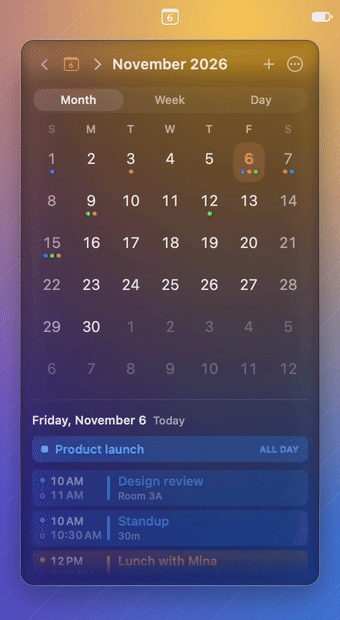

# Minical

**A small, glassy calendar that lives in your Mac's menu bar.**

Today's date sits in the menu bar. Click it for your month, week or day at a glance, with your real events, in a panel that looks at home on macOS 26's Liquid Glass.

<p align="center"></p>

<p align="center">
  <a href="https://github.com/jyun1004/Minical-releases/releases/latest/download/Minical.dmg"><b>Download Minical</b></a> (free, macOS 14 or later, Apple silicon and Intel)
  <br>
  <a href="https://jyun1004.github.io/Minical-releases/">jyun1004.github.io/Minical-releases</a>
</p>

## Features

- **Month, week and day views.** Page by month, week or day with a trackpad swipe, the scroll wheel, the chevrons or the keyboard; the panel resizes smoothly to fit each view.
- **Your real calendars.** Events from Calendar (iCloud, Google, Exchange: anything you've added there), with coloured dots, holidays and an agenda for the selected day. Pick which calendars show.
- **Day view.** What's next in large type, and the whole day as one glowing strip with a "now" marker. Point at an event to light it up, click it for its details.
- **Add events in place.** Press `+` or ⌘N, or double-click a time on the timeline.
- **Themes.** System, Black, Faded Glass, Dusk Glass, Liquid Glass (the real thing on macOS 26) and Pane in eight colours, each previewed live, plus your choice of highlight colour.
- **Keyboard first.** Every view and move has a key (see below).
- **Stays out of the way.** No Dock icon, launches at login if you like, and updates itself.

## Install

1. [Download the DMG](https://github.com/jyun1004/Minical-releases/releases/latest/download/Minical.dmg) and drag **Minical** to **Applications**.
2. Open it. The date appears in the menu bar; click it.
3. Allow calendar access when asked, so your events show up.

The interface is in English; a Korean translation is on the way.

Minical is signed with a Developer ID and notarized by Apple, so it opens without warnings. It checks for updates once a day; you can also choose **Check for Updates…** from the `⋯` menu.

## Privacy

Your calendar never leaves your Mac: Minical reads it through Apple's EventKit, runs in the App Sandbox, and has no accounts, analytics or tracking. The only thing it fetches from the internet is the update feed from Minical's GitHub releases.

## Keyboard

| Key | Action |
| --- | --- |
| ← → ↑ ↓ | Move the selected day |
| ⌘← / ⌘→, Page Up / Page Down | Previous / next month, week or day |
| ⌘1 / ⌘2 / ⌘3 (or D / W / M) | Day / week / month view |
| T | Jump to today |
| ⌘N | New event (Return saves, Esc cancels) |
| Return | Open Calendar |
| ⌘Q | Quit |

## Building from source

Requires Xcode 16+ (built with Xcode 27) and [XcodeGen](https://github.com/yonaskolb/XcodeGen).

```sh
xcodegen generate
xcodebuild -project Minical.xcodeproj -scheme Minical -configuration Release -derivedDataPath build/DerivedData build
open build/DerivedData/Build/Products/Release/Minical.app
```

### Release

`scripts/release.sh [version]` builds a universal (Apple silicon and Intel) app signed with a Developer ID, has Apple notarize it, staples the ticket and packages it as `dist/Minical-<version>.dmg`, ready to hand out outside the App Store. (Minical uses private macOS APIs to keep the panel still across Space switches and to tune its glass, so it can't go through App Store review.)

It needs, once:

1. A **Developer ID Application** certificate in the login keychain (Xcode → Settings → Accounts → Manage Certificates → + → Developer ID Application, signed in with the team's account).
2. Notary credentials, with an [app-specific password](https://account.apple.com) for that Apple ID:
   ```sh
   xcrun notarytool store-credentials minical-notary --apple-id <apple id> --team-id <team id> --password <app-specific password>
   ```

`SIGN_IDENTITY=- scripts/release.sh` signs ad hoc and skips notarization, to try the packaging alone.

Regenerate the app icon with `swift scripts/make-icon.swift Minical/Resources/Assets.xcassets/AppIcon.appiconset`.

Debug builds accept `--open` to show the panel at launch, `--preview-window` to show the popover content in a regular window, `--sample-data` to fill it with in-memory events, `--compose` to open the event composer, `--mode week|day|month` to pick the view, `--detail` to open the first event's details in day view, `--theme <name>` to preview a theme without saving it, `--appearance` to open the Appearance sheet, and `--slow-motion [factor]` to play the panel's fade in and out that many times slower (ten by default).

## License

Copyright © 2026 Jungyun Park. All rights reserved.

Minical is free to download and use. The source is published here to read; it isn't licensed for copying, modification or redistribution.
